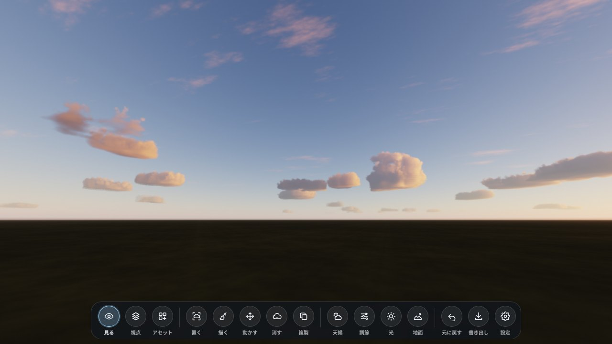
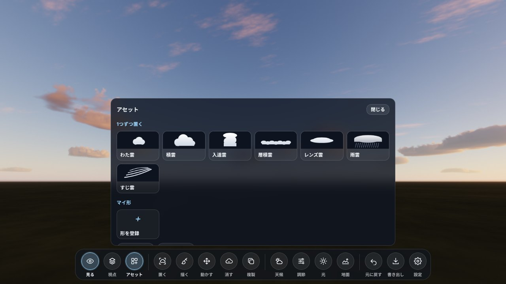
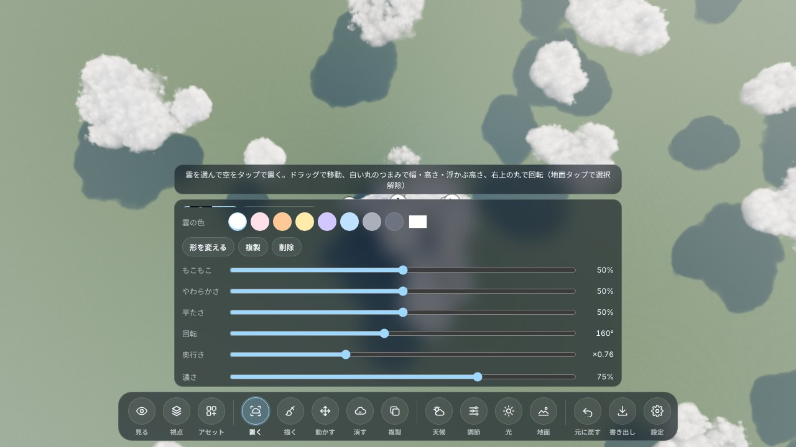

# FaveWeather ☁️

**写真の空加工とスカイボックス作成のためのツール**
*Sky editing for photos & skybox creation.*

FaveWeather は、空と雲をリアルに作って、写真に使ったり、3D の背景や照明に使ったりするためのオープンソースのツールです。

**▶ Web 版を開く：** https://YOUR-NAME.github.io/FaveWeather/

| 使う場所 | できること |
| --- | --- |
| **Web サイト**（PC・スマホ） | 空と立体の雲を作る／写真の空を加工する（雲を重ねる・空を置き換える・写真から空を再現）／HDRI スカイボックスを書き出す |
| **Blender**（アドオン） | Blender の中で空と立体の雲を作って編集する／本物に近い雲を Cycles で描く／360° HDRI を描画する／Web で作った空や雲の形を読み込む |
| **ゲームエンジン**（Unity・Unreal Engine・Twinmotion など） | 書き出した HDRI を取り込んで、背景と照明に使う |

## ✨ 主な機能

- **物理ベースの空**：太陽の高さ・方位、霞（大気の濁り）、時間帯を調整
- **立体の雲**：ボリュームで描く雲。雲量・高さ・種類・色を調整
- **雲を作る**
  - **置く**：わた雲・積雲・入道雲・層積雲・レンズ雲・雨雲・すじ雲を置いて、つまみで幅・高さ・浮かぶ高さ・回転を変える
  - **描く**：筆で塗る・輪郭で描く・ホワイトボードで描く
  - **動かす・消す・複製**
- **アセット**：雲の種類を選ぶ／空いっぱいに雲を敷く（うろこ雲・空一面の曇り・雷雲など）／ホワイトボードや写真から雲を作る
- **マイ形**：雲の写真や紙に描いた絵から、自分だけの雲の形を登録して何度でも置ける。ファイルで書き出して共有もできる
- **視点**：地上から見上げる／上から見下ろす・カメラの移動と高さ
- **天候**：快晴・晴れ・うす曇り・曇り・雨・雷雨・雪・霧・夕焼け・朝焼け・夕暮れ・夜など 22 種類。天候を変えても雲はそのまま
- **光の現象**：天使のはしご・日暈・幻日・環天頂アーク・光柱・彩雲・光環・月（満ち欠け）・天の川・流れ星・オーロラ
- **地面**：草原・砂漠・雪原・海・水鏡・雲海・山並み・街並み・地面なし／写真やカメラ映像を重ねる
- **画風**：リアル／アニメ背景風／水彩／ピクセル
- **書き出し**：HDRI（.hdr）＋プレビュー（.png）を zip で保存
- **設定**：6 言語（日本語・English・中文・한국어・Español・Français）／色覚設定／操作設定／Blender アドオンのダウンロード

| 雲のアセット | 雲の編集（上から見る） |
| --- | --- |
|  |  |

## 🚀 使い方

- **Web 版**：上のリンクを開くだけ。PC（Chrome / Edge / Safari）推奨、スマホでも動きます
- **手元で使う**：`index.html` をブラウザで開くだけ。インストール不要・1 ファイル完結です

## 🧩 Blender アドオン（FaveWeather）

**ダウンロード**：Web 版の「設定 → Blender 用アドオンをダウンロード」、または [Releases](../../releases) の `FaveWeather_Blender_Addon.zip`

**インストール**：Blender の「編集 > プリファレンス > アドオン」右上のメニューから「ディスクからインストール」で zip（または `blender/faveweather_importer.py`）を選ぶ。3D ビューで N キーを押し、サイドバーの「FaveWeather」タブを開く。

- **空**：「空を作る」で物理ベースの空と、向きのそろったサンライトを置く。太陽の高さ・方位・かすみ・空気・オゾン・明るさを調整。プリセット（快晴／朝／夕焼け／夕暮れ）
- **雲**：わた雲・積雲・入道雲・層積雲・レンズ雲・雨雲を「雲を置く」でカメラの前に追加、「雲を散らす」でまとめて配置。G で移動、S で拡大縮小
- **本物に近い雲の作り方**：大きな塊から小さなもこもこへ何段も重なった形を Geometry Nodes でボリュームにし、縁をノイズで削り、光は実際の水滴と同じ散り方（Mie 散乱）で計算
- **選んでいる雲**：色・濃さ・もこもこの細かさ、「形を変える」で別の形に
- **レンダリング**：「リアルな描画設定にする」で Cycles・ボリュームバウンス・AgX・デノイズ・GPU をまとめて設定（下書き／高品質／最高品質）。F12 で描画
- **360° HDRI を描画**：空全体を 2K／4K／8K の `.exr` に書き出す。Unity・Unreal・Twinmotion のスカイボックスにそのまま使える
- **アプリから読み込む**：Web で書き出した空の `.zip`（または `.hdr`）をワールドに設定。「アセット > マイ形 > 形を書き出す」で作った雲の形を、立体の雲として読み込む

雲はボリュームなので Cycles で描画します。Blender 4.2 以降に対応、Blender 5.3 で動作確認済み。GPU があると最高品質でも速く描けます。

## 🎯 スカイボックスの読み込み方

| ソフト | 読み込み方法 |
| --- | --- |
| Blender | World → Environment Texture に `.exr` / `.hdr` を指定（またはアドオンの「アプリから読み込む」） |
| Unity | テクスチャを Cube 形式にして Skybox マテリアルに設定 |
| Unreal Engine | HDRI Backdrop または Sky Light に指定 |
| Twinmotion | Environment → HDRI Sky に読み込み |

## 🗺 ロードマップ

- [x] 物理ベースの空・立体の雲・HDRI 書き出し
- [x] 雲を置く・描く・動かす・消す・複製・回転
- [x] アセットとマイ形（写真や絵から雲の形を登録）
- [x] 写真からの空の再現・ホワイトボードから雲
- [x] 光の現象・地面・画風・6 言語・色覚設定
- [x] Blender アドオン（空と雲の作成・編集、リアル描画、360° HDRI、Web からの読み込み）
- [ ] Web で置いた雲の配置をそのまま Blender に持っていく
- [ ] 上から見た形も指定できるマイ形
- [ ] Unreal Engine プラグイン
- [ ] 空プリセットの共有ギャラリー

## 🤝 コントリビュート

翻訳、雲や空のプリセット追加、バグ報告など、どんな協力も歓迎です。詳しくは [CONTRIBUTING.md](./CONTRIBUTING.md) へ。

## 📄 ライセンス

ソースコードは [MIT License](./LICENSE) で公開しています。
FaveWeather で作成・書き出した空の画像や HDRI は、作成者のものです。自由に使ってください。

---

### English (short)

FaveWeather is an open-source sky & cloud editor for **photo sky replacement** and **skybox (HDRI) creation**.

- **Web app** (PC & mobile, single `index.html`): physically based sky, volumetric clouds you place / paint / rotate, cloud assets and your own shapes from photos or drawings, 22 weather presets, optical phenomena, HDRI export.
- **Blender add-on**: create and edit the same skies and volumetric clouds inside Blender, realistic Cycles render presets, render a 360° HDRI, import skies and cloud shapes from the web app.
- **Game engines**: import the HDRI into Unity, Unreal Engine or Twinmotion.

MIT licensed. Everything you create with FaveWeather is yours.
